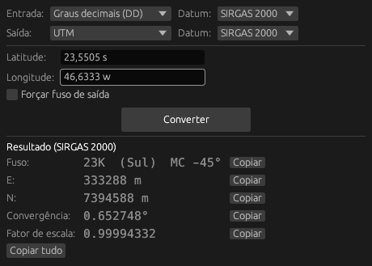

# Calculadora de Coordenadas

Conversor de coordenadas geográficas **DD ↔ GMS ↔ UTM**, com datums **SIRGAS 2000**, **WGS84** e
**SAD69**. É distribuído como **um único executável** (Windows `.exe` de ~3,4 MB ou binário Linux), que
abre instantaneamente e não precisa de instalação.



## Funcionalidades

- **Entrada** e **saída** em qualquer combinação de:
  - **DD**: graus decimais (`-23,5505`)
  - **GMS**: graus, minutos e segundos (`23°33'01,800" S`)
  - **UTM**: fuso, hemisfério, E e N em metros
- **Datum de entrada e de saída** independentes: SIRGAS 2000, WGS84 ou SAD69.
- **Fuso UTM automático**, incluindo as exceções da Noruega e de Svalbard. Também é possível
  **forçar o fuso** de saída, o que é útil para áreas na divisa entre dois fusos.
- **Saída UTM em metros inteiros**, no formato pedido nas solicitações de acesso de geração
  distribuída (ex.: CEMIG, fotovoltaica): `Fuso 23K · E 333288 · N 7394588`.
- Também mostra a **convergência meridiana** e o **fator de escala** do ponto.
- Botão **Copiar** em cada linha (copia só o número) e **Copiar tudo**.
- A janela é compacta e **se expande** para mostrar o resultado. Ela volta ao tamanho original
  quando qualquer entrada é alterada, então nunca se vê um resultado desatualizado.
- A tecla **Enter** também converte.

## Como usar

1. Escolha o formato de **Entrada** e o datum correspondente.
2. Escolha o formato de **Saída** e o datum desejado.
3. Preencha os campos e clique em **Converter** (ou pressione Enter).

### Formatos aceitos na entrada

| Formato | Exemplos aceitos |
|---|---|
| DD | `-23,5505` · `-23.5505` · `23,5505 S` · `46.6333W` · `46,6333 O` |
| GMS (campos separados) | Graus `23`, Min `33`, Seg `1,8` + seletor N/S ou E/W |
| GMS (colado no campo de graus) | `23°33'01,8"S` · `23 33 1.8 S` · `-23:33:01.8` · `S 23º 33′ 1,8″` |
| UTM | Fuso `23`, hemisfério N/S, E `333288`, N `7394588` (também `7.394.588,3` ou `7 394 588`) |

- O separador decimal pode ser **vírgula ou ponto**.
- Hemisférios: **N/S** para latitude e **E/W** ou **L/O** (leste/oeste) para longitude.
  O sinal `-` também indica sul/oeste.
- Entradas inválidas geram uma mensagem em vermelho que explica o problema, por exemplo minutos ≥ 60,
  latitude fora de ±90°, caractere não reconhecido ou fuso fora de 1–60.

### Formatos de saída

| Saída | Formato |
|---|---|
| DD | 7 casas decimais (~1 cm) |
| GMS | segundos com 3 casas decimais (~3 cm) |
| UTM | fuso + banda de latitude (ex.: `23K`), hemisfério, meridiano central, E e N em metros inteiros |

## Datums e precisão

| Datum | Elipsoide | Observação |
|---|---|---|
| SIRGAS 2000 | GRS80 | Referencial oficial do Brasil (padrão do programa) |
| WGS84 | WGS84 | Considerado idêntico ao SIRGAS 2000 (diferença de centímetros) |
| SAD69 | GRS67 (a = 6 378 160 m, 1/f = 298,25) | Convertido para SIRGAS 2000 por translação geocêntrica |

- **Projeção UTM:** série de Krüger de 6ª ordem (Karney, 2011), com precisão de nanômetros dentro do
  fuso. Comparada com o PROJ 9.8 em 1 000 pontos aleatórios nos três elipsoides, a diferença máxima foi
  de 1×10⁻⁸ m na ida e 1×10⁻¹³° na volta.
- **SAD69 ↔ SIRGAS 2000:** parâmetros do IBGE (R.PR 1/2005): ΔX = −67,35 m, ΔY = +3,88 m,
  ΔZ = −38,22 m. São os mesmos da transformação "SAD69 to SIRGAS 2000 (1)" do EPSG/PROJ, com
  **precisão de alguns metros**. Para trabalhos que exigem mais precisão, use o ProGriD do IBGE.

## Download / compilação

Pré-requisito: [Rust](https://rustup.rs) (1.85 ou mais recente).

```bash
# Linux
cargo build --release
# -> target/release/calculadora-coordenadas

# Windows (compilação cruzada a partir do Linux/WSL)
sudo apt-get install -y mingw-w64
rustup target add x86_64-pc-windows-gnu
cargo build --release --target x86_64-pc-windows-gnu
# -> target/x86_64-pc-windows-gnu/release/calculadora-coordenadas.exe
```

O `.exe` gerado depende apenas de DLLs do próprio Windows: basta copiá-lo e executá-lo. Também é
possível compilar nativamente no Windows com `cargo build --release`.

## Testes

```bash
cargo test
```

Os testes cobrem:
- pontos de referência calculados com o PROJ (São Paulo em SIRGAS 2000, Brasília em SAD69, entre outros);
- ida e volta DD → UTM → DD numa grade global, nos três elipsoides;
- exceções de fuso (Noruega e Svalbard) e divisas de fuso;
- a transformação SAD69 → SIRGAS 2000;
- o leitor de DD/GMS (vírgula decimal, símbolos, sinais e letras de hemisfério) e o arredondamento da saída.

Há também uma comparação opcional com um arquivo CSV gerado pelo PROJ (pyproj). Cada linha tem o
formato `elipsoide,lat,lon,fuso,E,N`, onde elipsoide é `wgs84`, `grs80` ou `sad69`:

```bash
PROJ_CSV=caminho/para/proj_ref.csv cargo test -- --ignored
```

## Estrutura do código

```
src/
├── main.rs            # inicialização da janela (eframe/egui)
├── app.rs             # interface: seletores, campos, resultado, ajuste do tamanho da janela
└── geo/               # núcleo de cálculo, sem dependência de interface
    ├── mod.rs         # convert(): entrada -> datum -> saída
    ├── ellipsoid.rs   # elipsoides e datums (SIRGAS 2000, WGS84, SAD69)
    ├── tm.rs          # projeção Transversa de Mercator (Krüger/Karney), direta e inversa
    ├── utm.rs         # fusos, bandas, falso E/N, exceções Noruega/Svalbard
    ├── datum.rs       # transformação geocêntrica entre datums
    └── dms.rs         # leitura e formatação de DD / GMS / metros
```

A interface usa [egui](https://github.com/emilk/egui) com renderização OpenGL (`glow`), sem
dependências de sistema além das bibliotecas gráficas padrão.

## Créditos e referências

- C. F. F. Karney, *Transverse Mercator with an accuracy of a few nanometers*, J. Geodesy 85(8),
  475–485, 2011. [arXiv:1002.1417](https://arxiv.org/abs/1002.1417)
- A estrutura do algoritmo da projeção foi adaptada de:
  - [chrisveness/geodesy](https://github.com/chrisveness/geodesy), © Chris Veness, licença MIT;
  - [GeographicLib](https://geographiclib.sourceforge.io/), © Charles Karney, licença MIT.
- IBGE, Resolução R.PR 1/2005: parâmetros de transformação SAD69 → SIRGAS 2000.
- Versão anterior deste projeto (Java) baseada na Calculadora Geográfica do INPE.

## Licença

[GNU GPL v3](LICENSE).
